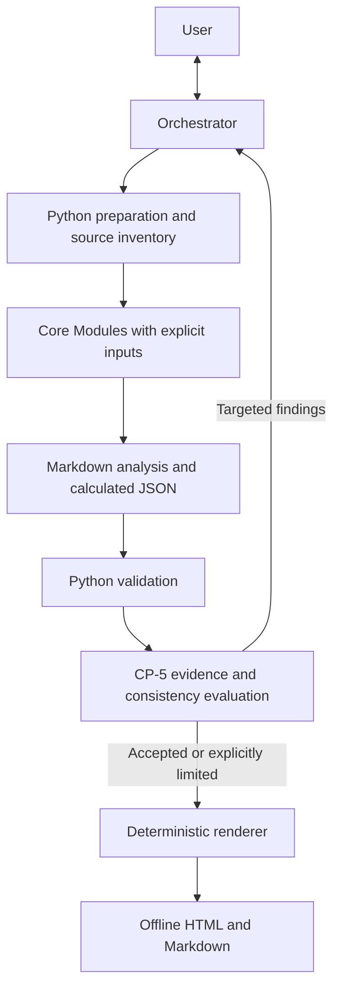

# Architecture research — 2026-10-20

Updated for the user's follow-up requests. This is the proposed Deploy VII design;
historical comparisons do not import another project's instructions.

## Recommendation

Use a fixed, dependency-aware workflow with one user-facing orchestrator and
selective Module delegation. Begin sequentially. Add parallelism only for truly
independent inputs and measured latency benefits. Keep evaluation bounded and
triage within the orchestrator initially. This is a research recommendation;
no runtime framework is selected or installed.

The user's [ICM question](development-context.md) concerns development context
and handoffs only. It does not select this product's folder architecture.
The required frontend is [Direction C Workbench](frontend-direction-c.md), with
each tested Module populating its own fields during development. The
[Deploy VI review](deploy-vi-reuse.md) identifies existing implementation candidates.

The [methodology review](methodology-adaptation.md) finds that handoffs and
validation need adaptation, while a full financial-method rewrite is not justified
by this architecture. Old prompt cuts, budgets and phase groupings need a fresh
case. [Maintenance sweeps](maintenance-sweeps.md) are bounded checkpoints after a
proven layer and at integration, not a second approval process.

Compared with the sequential simple-pathways session, separate contexts reduce
context crowding and make retries local to a Module, but add dispatch latency,
handoff validation and failure states. Deploy VI's earlier RBOT already delegated
Modules, so delegation alone is not a new optimization. The larger opportunity
is caching source preparation, exact calculations and validated artifacts, then
rerunning only invalidated consumers. Measure that before adding concurrency.

## Core milestones

| Layer | Core result | What the live test must demonstrate |
| --- | --- | --- |
| CP-0 | Source readiness and confirmed brief | Correct issuer/period, readable evidence, stable source identities and visible gaps. |
| CP-1 | Canonical financial/debt/instrument registers and Python Model | Source reconciliation, period/units fidelity and reproducible derived figures. |
| CP-2 | Fundamental credit synthesis | Evidence supports the credit view; definitions and missing inputs constrain conclusions. |
| CP-3 | Relative value and security selection | Script-owned pricing, current comparable evidence, talk distinguished from market. |
| CP-4 | Core legal/covenant interpretation | Clauses, entities and conditions are traced; absent capacity/headroom stays unknown. |
| CP-5 | Cross-Module evidence trace | Material conclusions have lineage; contradictions return to their owning Module. |

Development order must preserve the selected method's dependencies. As comparative
evidence, checkpoint `16617a0` required CP-0/CP-1/CP-1A/MODEL before CP-2 and
CP-0/CP-1/MODEL before CP-3. Porting that method requires CP-1A's business context
despite the short numbering. Judgment/fallback semantics need explicit fidelity
checks. CP-4 was absent from that pinned bundle. The newer locally recorded
`bd71346` snapshot contains it, as documented in the [reuse review](deploy-vi-reuse.md);
presence does not establish completeness or qualification in Deploy VII.

When CP-4 or an extension changes inputs consumed by earlier analytical views,
revalidate and rerun affected consumers. CP-5 evaluates the resulting consistent
set. Existing CP-6/final-synthesis obligations must be resolved explicitly before
claiming a complete assessment; reaching CP-5 is the core milestone.

## Boundaries that matter

- Skill: reusable method, instructions and tools. Module: analytical responsibility.
  Agent: execution context. These do not need one-to-one packaging.
- The orchestrator receives artifact paths, hashes, status and concise findings;
  it need not carry every source and every full Module output in chat history.
- Handoffs include issuer, as-of date, period, units, source IDs, method version,
  input identities, findings and explicit gaps. Preserve tagged tables and citations.
- Python owns arithmetic and mechanical source checks. CP-5 judges material
  support and consistency; it cannot silently repair another Module's conclusions.
- Build/adapt the Direction C template once. Each completed Module test produces
  a labelled preview and updates the accepted report only after validation.
  Python prepares the data; deterministic HTML/JS presents it. An LLM should
  not rewrite numbers or rebuild arbitrary report HTML on every run.
- Retry limits need a concrete policy before execution. A suggested starting
  experiment is one targeted repair, then a visible restriction or block.
- Core development live gates use OpenRouter here. Test with the same methods,
  handoff contracts and tools intended for Copilot; record the adapter difference.
  Use the user's random Luna/GLM/DeepSeek pool and retain all attempts under the
  [test evidence policy](testing-and-telemetry.md). Provider/model response
  metadata does not prove native Copilot behavior.

## Patterns and frameworks

| Candidate | Benefit for this architecture | Cost or mismatch | Recommendation |
| --- | --- | --- | --- |
| Native Copilot skill + Python helpers | Fits one-invocation delivery and existing deterministic methods | Host dispatch, tools and context behavior still need acceptance | Preferred product baseline. |
| Direct OpenRouter calls + small Python test runner | Transparent prompts, outputs and usage; few dependencies | Must implement bounded tool loops and validation where actually needed | First test-runner option. |
| Pydantic AI | Typed outputs, Python tools, OpenRouter integration and programmatic handoffs | Adds another execution layer; cannot prove native CLI parity | Leading optional test-runner library. |
| LangGraph | Explicit state transitions, checkpointing, interrupts and durable workflows | Persistence and replay semantics add work before core analysis is proven | Revisit for demonstrated recovery/branching needs. |
| Copilot SDK | Programmatic access to Copilot capabilities | An embedding application is a different delivery shape from an installed skill | Use only if CLI automation requires it. |
| Microsoft Agent Framework | Python/.NET agents, explicit workflows and enterprise integrations | Broader host/integration surface than this local pipeline needs | Revisit for enterprise service deployment. |
| CrewAI Flows/Crews | Role/task modeling and explicit flow composition | Potential overlap between framework managers and the existing orchestrator | Secondary option; no demonstrated advantage here. |

Framework capabilities above come from [primary documentation](research-sources.md).
Suitability is our inference, not benchmark evidence. Avoid a free-form swarm:
this process has known stages, shared financial definitions and explicit owners.
MCP can expose tools later; it is not itself a workflow scheduler.

Development uses the [Claude/GPT role matrix](model-matrix.md). Workers return
local commits from isolated worktrees; the [coordinator](pr-worktree-workflow.md)
owns publication by default and checks the combined candidate. These development
roles are separate from runtime Modules and their future Copilot models.

## Research acceptance before implementation

Agree the CP-0 input/output contract and real-pack selection, select a bounded
test runner, and define a factual live rubric. Compare later framework candidates
on the same inputs and tool permissions: accepted output quality, citation errors,
failed/refused cases, latency, tokens/cost and repair attempts. Preserve raw local
evidence. Do not build a general benchmarking platform first.

Not verified: live layer quality, framework performance, native CLI equivalence,
parallel speedup, required model availability or the final implementation choice.
